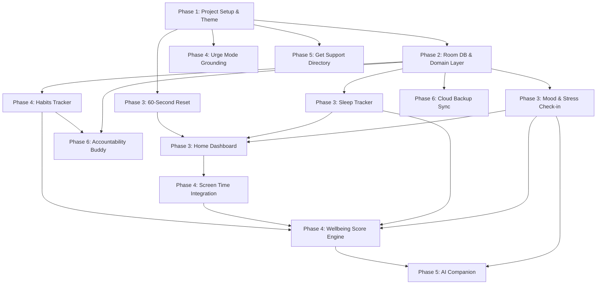

# MIND CHECK — Step-by-Step Development Plan

> **Document Type:** Implementation Roadmap & Technical Execution Plan  
> **Status:** Proposal — Pending User Approval  
> **Target Application:** Mind Check (Native Android, Jetpack Compose, MVVM)  
> **Author:** Antigravity AI & Development Team  

---

## 1. Executive Summary & Phased Strategy

To avoid project bloat and ensure reliable software quality, development is divided into **small, verifiable, sequential phases**. Each phase produces a testable increment on an Android device or emulator before the next phase begins.

```
┌────────────────────────────────────────────────────────────────────────┐
│ Phase 0: Planning & Specification (Current)                           │
│ - Finalize specifications, feature scope, and safety boundaries       │
└──────────────────────────────────┬─────────────────────────────────────┘
                                   │
                                   ▼
┌────────────────────────────────────────────────────────────────────────┐
│ Phase 1: Project Foundation & Design System (Compose & M3)            │
│ - Android Studio project structure, Gradle Version Catalog, M3 tokens  │
└──────────────────────────────────┬─────────────────────────────────────┘
                                   │
                                   ▼
┌────────────────────────────────────────────────────────────────────────┐
│ Phase 2: Local Persistence & Domain Layer                             │
│ - Room Database, DAOs, Repositories, Domain Models, Unit Tests        │
└──────────────────────────────────┬─────────────────────────────────────┘
                                   │
                                   ▼
┌────────────────────────────────────────────────────────────────────────┐
│ Phase 3: Core MVP Screens & Interactions                              │
│ - Dashboard, Daily Check-in, Sleep Tracker, 60-Second Reset           │
└──────────────────────────────────┬─────────────────────────────────────┘
                                   │
                                   ▼
┌────────────────────────────────────────────────────────────────────────┐
│ Phase 4: Heuristics, Digital Wellbeing & Self-Help Tools              │
│ - UsageStats integration, Wellbeing Score engine, Urge Mode, Habits   │
└──────────────────────────────────┬─────────────────────────────────────┘
                                   │
                                   ▼
┌────────────────────────────────────────────────────────────────────────┐
│ Phase 5: Support Directory & AI Companion Integration                 │
│ - Crisis hotline directory, on-device AI reflection prompts           │
└──────────────────────────────────┬─────────────────────────────────────┘
                                   │
                                   ▼
┌────────────────────────────────────────────────────────────────────────┐
│ Phase 6: Cloud Enhancements, Peer Buddy & Release Readiness           │
│ - Optional Firebase sync, Accountability Buddy, Security hardening    │
└────────────────────────────────────────────────────────────────────────┘
```

---

## 2. Phase-by-Phase Implementation Order & Deliverables

### Phase 0: Project Planning & Architecture Alignment (Current Phase)
- **Deliverables:**
  - `PROJECT_SPEC.md` (Comprehensive architecture and feature specification)
  - `DEVELOPMENT_PLAN.md` (Implementation roadmap and risk analysis)
  - Standard `.gitignore` and initial GitHub repository configuration.
- **Verification Gate:** User explicitly reviews and approves the project specification, data model, and safety guardrails.

---

### Phase 1: Android Studio Project Foundation & Design System Setup
- **Objective:** Establish a clean, compiling native Android project with Jetpack Compose, Material 3, and dependency injection.
- **Deliverables:**
  1. Root and app `build.gradle.kts` configured with Gradle Version Catalog (`gradle/libs.versions.toml`).
  2. Dependencies configured: AndroidX Core, Lifecycle, Compose BOM, Navigation Compose, Hilt, Room, Coroutines.
  3. Design System Foundation:
     - Theme palette (`Color.kt`, `Theme.kt`) with light/dark dynamic Material 3 support.
     - Typography tokens (`Type.kt`) using clean, accessible typography.
     - Reusable UI kit components: `MindCheckCard`, `MindCheckButton`, `MindCheckSlider`, `MindCheckTopBar`.
  4. Scaffold navigation host (`MindCheckNavHost`) with placeholder screen destinations.
- **Verification Gate:**
  - Project builds successfully via `./gradlew assembleDebug`.
  - Placeholder app launches on an Android emulator (API 34+) displaying the Material 3 themed scaffold.

---

### Phase 2: Local Persistence & Core Domain Layer
- **Objective:** Implement reliable, local-first data storage with Room and clean domain interactors.
- **Deliverables:**
  1. Room entities: `MoodEntryEntity`, `SleepEntryEntity`, `HabitEntity`, `HabitLogEntity`, `WellbeingSnapshotEntity`.
  2. Type converters for lists and date-time representations.
  3. Room DAOs: `MoodDao`, `SleepDao`, `HabitDao` with reactive `Flow` query methods.
  4. `MindCheckDatabase` definition with initial migration strategy (fallback to destructive migration during alpha development only).
  5. Repository interfaces and implementations: `MoodRepositoryImpl`, `SleepRepositoryImpl`, `HabitRepositoryImpl`.
  6. Jetpack Preferences DataStore wrapper for user onboarding state.
- **Verification Gate:**
  - Automated unit and instrumentation tests pass for all DAOs (insert, query, filter by date range, delete).
  - Repository unit tests using mock DAOs verify data mapping between Room entities and pure domain models.

---

### Phase 3: Core MVP Screens & Flows
- **Objective:** Deliver the primary functional loop of the application: Daily Check-in, Sleep Tracking, 60-Second Reset, and the Home Dashboard.
- **Deliverables:**
  1. **Home Dashboard Screen:**
     - Quick summary card displaying today's logging status.
     - Quick-action buttons to launch check-in, sleep logger, and 60-second reset.
     - Recent mood timeline row.
  2. **Daily Mood & Stress Check-In Flow:**
     - 5-point animated mood selector.
     - 1–10 stress scale slider with real-time feedback.
     - Categorical tag selector (Academic, Social, Health, etc.).
     - Optional personal note text field.
     - Successful submission persists to Room and updates the Dashboard reactively.
  3. **Sleep & Energy Logger:**
     - Time picker for bedtime and wake-up time.
     - Quality and morning energy star/gauge selector.
     - Room persistence and recent sleep history card.
  4. **60-Second Reset Tool:**
     - Animated Compose canvas guiding 4-7-8 or Box breathing.
     - Tactile haptic feedback integration on inhale/exhale cycles.
- **Verification Gate:**
  - End-to-end user flow: user completes a check-in and sleep entry; data is immediately visible on the Dashboard.
  - State survives screen rotation and app process death.

---

### Phase 4: Digital Wellbeing Heuristics, Scoring & Grounding Tools
- **Objective:** Enrich the app with automated screen usage insights, the heuristic Wellbeing Score, Urge Mode, and habit tracking.
- **Deliverables:**
  1. **Screen Usage Tracking:**
     - Permission flow for `Settings.ACTION_USAGE_ACCESS_SETTINGS`.
     - `ScreenTimeDataSource` wrapping Android `UsageStatsManager`.
     - Daily total screen time and top 3 distracting apps breakdown.
     - Graceful fallback UI when permission is not granted.
  2. **Wellbeing Score Engine:**
     - Pure Kotlin `CalculateWellbeingScoreUseCase` combining mood, stress, sleep, screen time, and habits.
     - Daily `WellbeingSnapshot` calculation and persistence.
     - Visual score ring on the Dashboard with qualitative status (e.g., "Thriving", "Steady", "Recharge Needed").
  3. **Urge Mode (SOS Grounding):**
     - Step-by-step interactive 5-4-3-2-1 grounding exercise.
     - Somatic de-escalation tips (cold water reset, muscle clench-release).
  4. **Habits & Micro-Goals:**
     - Daily checklist of self-care habits.
     - Streak counter and completion percentage calculation.
- **Verification Gate:**
  - Scoring engine unit tests pass across 20+ edge cases.
  - Screen time displays accurately compared to Android System Digital Wellbeing.
  - Urge Mode is accessible from any screen within 1 tap.

---

### Phase 5: Get Support Directory & AI Wellness Companion
- **Objective:** Provide safety crisis resources and introduce an empathetic reflective AI companion with strict ethical boundaries.
- **Deliverables:**
  1. **Get Support Screen:**
     - Verified national and regional crisis phone/text hotlines with direct dialer intents.
     - Customizable campus counseling directory fields.
     - Permanent medical emergency safety notices.
  2. **AI Wellness Companion Screen:**
     - Conversational UI for self-reflection and journal prompting.
     - Safety classifier: immediate trigger keyword interception (e.g., suicide, self-harm) that immediately surfaces crisis numbers and terminates conversational generation.
     - Empathetic reflective response generation using on-device prompt templates or safe API integration.
- **Verification Gate:**
  - Emergency dialer intents trigger system phone dialer with correct numbers.
  - Safety filter successfully intercepts 100% of crisis test prompts.

---

### Phase 6: Cloud Enhancements, Peer Buddy & Production Polish
- **Objective:** Optional cloud synchronization, peer accountability buddy, and release preparation.
- **Deliverables:**
  1. Optional Firebase Authentication (Anonymous and Email/Google).
  2. Cloud Firestore encrypted backup sync.
  3. Accountability Buddy feature:
     - Share check-in completion streaks with a peer code.
     - Zero sharing of private mood notes or scores.
  4. Security & Privacy Hardening:
     - Clear Data & Export Data functions in Settings.
     - Release ProGuard / R8 rules verification.
     - Accessibility audit (TalkBack, contrast, touch targets).
- **Verification Gate:**
  - Release APK/AAB builds cleanly with minification enabled.
  - Zero sensitive data leaks verified in network traffic logs.

---

## 3. Feature Categorization: MVP vs. Future Enhancements

| Feature | Phase | Classification | Reason |
| :--- | :---: | :---: | :--- |
| **Material 3 UI Scaffold & Theming** | Phase 1 | **MVP Core** | Foundation for all visual presentation. |
| **Room Database & Local Persistence** | Phase 2 | **MVP Core** | Fundamental data sovereignty requirement. |
| **Home Dashboard** | Phase 3 | **MVP Core** | Central navigation and daily summary hub. |
| **Daily Mood & Stress Check-In** | Phase 3 | **MVP Core** | Core daily engagement mechanism. |
| **Sleep & Energy Tracker** | Phase 3 | **MVP Core** | Vital lifestyle correlation parameter. |
| **60-Second Reset (Breathing)** | Phase 3 | **MVP Core** | Instant self-contained de-escalation utility. |
| **Urge Mode Grounding (5-4-3-2-1)** | Phase 4 | **MVP Core** | Essential acute distress intervention tool. |
| **Screen Usage Tracking** | Phase 4 | **MVP Core** | Differentiator for student digital wellbeing. |
| **Heuristic Wellbeing Score** | Phase 4 | **MVP Core** | Core synthesizing insight for the user. |
| **Micro-Habits & Streaks** | Phase 4 | **MVP Core** | Promotes long-term retention and positive action. |
| **Get Support (Crisis Directory)** | Phase 5 | **MVP Core** | Critical safety requirement for mental wellness apps. |
| **AI Wellness Companion** | Phase 5 | **Post-MVP** | Requires strict safety guardrail evaluation. |
| **Firebase Cloud Backup** | Phase 6 | **Post-MVP** | App must be fully functional offline first. |
| **Accountability Buddy (Peer)** | Phase 6 | **Post-MVP** | Introduces multi-user sync and backend complexity. |

---

## 4. Dependencies Between Features



---

## 5. Major Technical Risks & Mitigation Strategies

| Risk Description | Severity | Probability | Concrete Mitigation Strategy |
| :--- | :---: | :---: | :--- |
| **`UsageStatsManager` Permission Friction**<br>Users may deny or fail to find the Special App Access screen for usage statistics. | High | High | Design the UI to treat screen time as strictly optional. Provide a clear visual tutorial on how to enable it. If denied, provide a manual estimation picker so the Wellbeing Score never breaks. |
| **Misinterpretation as Clinical Diagnosis**<br>Users might believe a low Wellbeing Score indicates clinical depression or anxiety. | Critical | Medium | Embed explicit non-diagnostic disclaimers on every score screen. Frame scores strictly as "Daily Wellness Balance" rather than a mental health evaluation. |
| **AI Hallucination & Safety Hazards**<br>AI companion could give inappropriate clinical advice or fail to handle self-harm inputs safely. | Critical | Low | Hardcode a client-side regex safety interceptor that blocks any conversational query containing self-harm keywords, instantly replacing it with crisis emergency numbers. |
| **Battery Drain from Background Tracking**<br>Frequent background monitoring could cause high battery drain, resulting in uninstalls. | Medium | Medium | Do **not** run background polling services for screen time. Read `UsageStatsManager` query ranges on-demand when the user opens the app or views the screen time tab. |
| **Data Loss on App Update or Crash**<br>Local Room schema updates could wipe user historical mood logs. | High | Low | Implement Room automated migrations (`AutoMigration`) with comprehensive test verification before releasing schema updates. |

---

## 6. Testing Criteria & Quality Gates

Before any phase is marked complete, it must satisfy the following checklist:

1. **Build Quality:**
   - `./gradlew compileDebugKotlin` completes with zero errors.
   - Kotlin compiler warnings treated with strict hygiene.
2. **Device / Emulator Verification:**
   - Tested on an Android 14 / 15 emulator (Pixel 7 / 8 profile) and verified on an actual physical Android device.
   - Screen renders without clipping across various screen sizes and font-scaling settings.
3. **Architecture Conformity:**
   - UI components contain zero business logic or direct database calls.
   - All state is managed via `StateFlow` inside `ViewModel` instances.
4. **Data Integrity:**
   - App preserves logged data when closed, backgrounded, or when device is rotated.
5. **Privacy Adherence:**
   - No logcat statements outputting personal notes or mood entries in release builds.

---

## 7. Decisions Requiring User Approval

Before proceeding to Phase 1, the following architectural and project decisions require your review and explicit approval:

1. **Target Minimum Android SDK Version:**
   - *Recommendation:* **minSdk = 26 (Android 8.0 Oreo)**, covering >95% of active Android devices while allowing modern Java/Kotlin time APIs. Target SDK: **34 / 35**.
2. **AI Wellness Companion Strategy:**
   - *Option A:* Client-side structured reflective journaling prompts (100% offline, zero API costs, zero hallucination risk).
   - *Option B:* Cloud LLM API integration (e.g., Gemini API or Firebase Vertex AI) with client-side crisis safety filters.
   - *Recommendation:* Start with Option A for Phase 3–4, then layer Option B in Phase 5 with safety guardrails.
3. **Package & Application ID:**
   - Proposed Application ID: `com.mindcheck.app` (or custom name such as `com.hrithi.mindcheck`).
4. **Screen Time Tracking Consent UX:**
   - Prompt user during initial onboarding vs. prompt on-demand only when opening the Digital Wellbeing tab.
   - *Recommendation:* Prompt on-demand when user visits the tab, explaining the benefit first.
